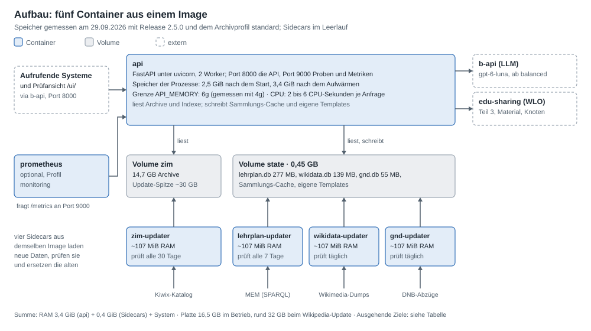

# Antworten für das IT-Team

[Übergabe](README.md) · Stand 15.10.2026 · Release 2.23.0 (Stand bis D112)

Team 6 hat in „Übergaben an den Maschinenraum“ festgelegt, was ein Dienst erfüllen und bei der Übergabe mitbringen muss,
und in „B-API: Authentifizierung über den durchgereichten Authorization-Header“, wie ein Dienst hinter dem Proxy der
b-api mit dem Schlüssel des Aufrufers umgeht. Diese Seite beantwortet beide Dokumente Frage für Frage, in deren
Reihenfolge. Jede Antwort nennt die Stelle, an der es ausführlich steht. Was offen ist, steht am Ende.

Kurz: Der Dienst „Kompendiale Texte“ erzeugt zu einem Thema, einem Material oder einer Sammlung einen
Überblickstext (Teil 1, aus Wikipedia und Klexikon), passende Lehrplanstellen (Teil 2) und Materialien aus WLO
(Teil 3), dazu QA-Paare und Entitäten. Er läuft als ein Image in fünf Containern: die API und vier Sidecars, die die
lokalen Daten aktuell halten.

## 1. API und Endpunkte

### OpenAPI-Spezifikation

| Frage | Antwort |
|---|---|
| Liefert der Dienst eine OpenAPI-Spec? | Ja, OpenAPI 3.1, aus dem Code erzeugt (FastAPI), nie von Hand gepflegt. Sie ändert sich mit jedem Commit mit |
| Wo liegt sie? | `GET /openapi.json` am Port der API; lesbar unter `/docs` (Swagger UI) und `/redoc`. `API_DOCS_ENABLED=false` schaltet alle drei ab |
| Anzeigename und Text für Endnutzende? | `info.title` „Kompendiale Texte“, `info.summary` ein Satz für Endnutzende (Grundlage für den Produktkatalog), `info.description` für Entwickler (D107) |
| Beschreibt sie die Nutzung vollständig? | Ja: jeder Endpunkt mit Kurztitel, Beschreibung, Beispielen von der kürzesten Anfrage bis zu allen Parametern und den Fehlerantworten, jede Gruppe mit einem Text. Tests halten Beispiele und Beschreibungen vollständig (`tests/test_openapi_catalog.py`, `tests/test_docs_examples.py`). Eine eigene Nutzungsdoku für Aufrufer gibt es zusätzlich ([aufrufe.md](aufrufe.md)) |

### Öffentliche und Infrastruktur-Endpunkte trennen

| Frage | Antwort |
|---|---|
| Stehen Health, Ready und Metriken in der Spec? | Nein. `/openapi.json` beschreibt nur die öffentlichen Endpunkte; die internen stehen in [betrieb.md, „Erreichbarkeit“](../betrieb.md#erreichbarkeit), ein Test hält die Liste vollständig (D107) |
| Zwei Ports? | Ja (D110). Port 8000 (`PUBLIC_PORT`) ist die API und wird über den Ingress freigegeben. Port 9000 (`INTERNAL_PORT`) liefert `/health`, `/ready`, `/metrics`, `/api/v2/zim/status` und `/api/v2/lehrplan/status`; am Port 8000 antworten diese Pfade mit 404. Entschieden wird nach dem Socket, an dem die Verbindung ankam, nicht nach Host-Header oder Proxy-Headern; ein Präfix (`root_path`) öffnet sie nicht |
| Was nutzt Kubernetes? | Liveness `GET /health`, Readiness `GET /ready`, beide am Port 9000; ServiceMonitor `GET /metrics` am Port 9000 ([Beispiel-Values](helm-values.example.yaml)) |
| Welche Pfade gibt der Ingress frei? | Am Port 8000 `/api/v2/` ohne die Admin-Pfade, dazu `/openapi.json`, `/docs`, `/redoc` (Liste in den Beispiel-Values unter `ingress.paths`). Die Admin-Pfade (ZIM-Sync, Harvest, Templates schreiben, Archiv löschen) liegen am Port 8000 hinter `ADMIN_TOKEN`, weil sie von Hand aufgerufen werden; sie gehören nicht in den Ingress |
| Sind beide Ports einstellbar? | Ja (D111): `PUBLIC_PORT` und `INTERNAL_PORT`, nur nicht gleich. `INTERNAL_PORT=0` legt alles auf einen Port. Mehrere Dienste auf einem Host: mit Docker über die Host-Ports `API_BIND` und `INTERNAL_BIND`, ohne Container über `PUBLIC_PORT` und `INTERNAL_PORT` ([betrieb.md](../betrieb.md#erreichbarkeit)) |

### Header, Content-Types, Antwortzeiten

| Frage | Antwort |
|---|---|
| Welche Header braucht der Dienst vom Client? | Hinter der b-api `Authorization` (sonst `X-API-Key`): der Schlüssel, den die b-api vom Aufrufer weiterreicht und den der Dienst für seine LLM-Aufrufe braucht (D105). Optional `X-Request-ID`, `x-client-trace-id`, die B3-Header und `traceparent`/`tracestate`, damit Logs dienstübergreifend filterbar sind (D108). `X-Admin-Token` nur für die Admin-Pfade. Direkt erreichbar (Variante B): `X-API-Key` mit einem Schlüssel aus `API_KEYS` |
| Welche Header gibt er zurück? | `X-Request-ID` an jeder Antwort (für Rückfragen und das Log). Dazu nur, was HTTP verlangt: `WWW-Authenticate` bei 401, `Retry-After` bei 429 (nur mit `RATE_LIMIT` über 0), `ETag` beim Lesen und Schreiben eines Templates. Die HTML-Seiten `/docs`, `/redoc` und `/ui/` tragen Sicherheits-Header (`Content-Security-Policy`, `X-Content-Type-Options`, `Referrer-Policy`) |
| Content-Types? | Anfragen und Antworten `application/json`. Anderes liefern nur `/metrics` (Textformat für Prometheus, interner Port), `/docs` und `/redoc` (HTML) und die Prüfansicht `/ui/` (HTML, JavaScript, CSS; im Betrieb aus). Kein Streaming, keine SSE, keine Dateien |
| Erwartete Antwortzeiten? | Ein Kompendium (Teil 1 und 2) im Median: `llm-free` 3 s, `balanced` 4 s, `best-quality` 15 s, `best-quality-generated` 28 s, `best-coverage-generated` 33 s (M91, neun Themen). Mit Teil 3 und Materialtexten kommt das Lesen des Repositorys dazu. Fünf gleichzeitige Anfragen dauerten je 9 bis 42 s ([Lastmessung](README.md#lastmessung-vom-29092026)). Die harte Frist ist `REQUEST_TIMEOUT_S`: mit OpenAI 300 s, mit academiccloud 600 s |
| Welche Timeouts in Proxy und Ingress? | Mindestens 330 s (mit academiccloud 630 s); in den Beispiel-Values `ingress.timeoutSeconds: 330` |
| Asynchrone Jobs? | Nein, die Anfragen bleiben synchron. Ein Job, der nach der Anfrage weiterläuft, müsste den Schlüssel des Aufrufers über die Anfrage hinaus halten, was die b-api ausschließt, und bräuchte eine Warteschlange. Die schreibenden Profile über 30 s sind darum ein Grund für die langen Timeouts |

## 2. B-API-Integration und Authentifizierung

### Variante A: über die b-api (empfohlen)

| Frage | Antwort |
|---|---|
| Wer authentifiziert? | Die b-api. Der Dienst prüft den Schlüssel nicht selbst und darf darum nur über die b-api erreichbar sein (NetworkPolicy oder internes Ingress) |
| Einstellungen | `LLM_ENABLED=true`, `B_API_KEY_SOURCE=request`, `API_KEYS` leer, `RATE_LIMIT=0` (die b-api begrenzt je Schlüssel, D104) |
| Braucht der Dienst den virtuellen Schlüssel? | Ja, ab dem Profil `balanced` ruft er selbst ein LLM. Ohne Profil im Aufruf gilt `PRESET_DEFAULT` |
| Welche Rechte braucht der Schlüssel? | Der Schlüssel der Aufrufer: LLM-Aufrufe an `/api/v1/llm/openai/chat/completions`, mit Routing an `/api/v1/llm/router/…`. `B_API_KEY` zusätzlich `/api/v1/llm/openai/models` für die Modellprüfung. Keine Routenverwaltung (`LLM_ROUTE_MANAGE`), kein Admin |
| Welche Modelle und Routen? | Vorgabe ohne Routing: Provider `openai` mit `gpt-6-luna` (`B_API_PROVIDER=openai`, `B_API_MODEL`). Eine Route legt ein Administrator der b-api an, global, denn eine Route eines einzelnen Schlüssels sehen die Schlüssel der Aufrufer nicht; Vorschlag: `gpt-6-luna` mit `gpt-5.6-luna` als Reserve, eine Parameterfamilie. Dann `B_API_PROVIDER=router` und `B_API_ROUTE` setzen (D97) |
| Was am Proxy-Dienst einstellen? | Eintrag `compendious-text-generator` mit `baseUrl` auf Port 8000 des Dienstes, „API-Key des Aufrufers weiterreichen“ (`forwardApiKey`) an, Timeout mindestens 330 s |
| Was passiert bei einem erreichten Limit? | Die b-api lehnt ab (401, 402, 403, ein 429 auch nach den möglichen Versuchen; ebenso ein 404 für eine Route, die der Schlüssel nicht sieht). Der Rest dieser Anfrage läuft ohne LLM nach den Regeln (`llm-free`), die Antwort nennt den Grund, das Log sagt es einmal je Anfrage als WARNING `b-api refused the key of this request`. Andere Anfragen behalten das LLM (D106) |
| Braucht es `B_API_KEY`? | Nur für Aufrufe ohne Schlüssel (Direktaufrufe im Cluster, Prüfungen). Ohne ihn laufen solche Anfragen nach den Regeln. Die Modellprüfung beim Start und in `/health` fragt nur mit `B_API_KEY`. Lehnt die b-api `B_API_KEY` ab, laufen die Anfragen ohne eigenen Schlüssel zehn Minuten ohne LLM; Anfragen mit eigenem Schlüssel behalten es |

### Variante B: ohne b-api (Ausnahme)

| Frage | Antwort |
|---|---|
| Env-Variablen für LLM-Zugang | `LLM_ENABLED=true`, `B_API_KEY` (Secret), `B_API_KEY_SOURCE=env` (Vorgabe); `B_API_BASE_URL` nur, wenn die b-api nicht zu `EDU_SHARING_BASE_URL` passt (sonst folgt sie ihm: Staging oder Produktion) |
| Eigene Auth-Schicht | `API_KEYS`: Schlüssel der aufrufenden Systeme, kommagetrennt, je mindestens 16 Zeichen, im Header `X-API-Key`; alle Endpunkte mit einem Profil verlangen dann einen (401 sonst). `RATE_LIMIT` begrenzt je Aufrufer und Minute. Rechte je Schlüssel gibt es nicht: Jeder Schlüssel darf alle öffentlichen Endpunkte. Admin-Pfade verlangen getrennt `ADMIN_TOKEN` |
| Wo werden Schlüssel angelegt? | `B_API_KEY` legt ein Administrator der b-api an. Die Schlüssel in `API_KEYS` erzeugt der Betrieb selbst (`openssl rand -hex 32`) |
| Wie werden sie getauscht? | Neuen Wert ins Secret, dann Rollout: Die API liest ihre Einstellungen beim Start. `API_KEYS` erlaubt einen Wechsel ohne Ausfall: neuen Schlüssel dazunehmen, Aufrufer umstellen, alten entfernen |
| Zwei Ports, mit und ohne Auth? | Ja: Port 8000 mit `API_KEYS` für den externen Zugang. Am Port 9000 brauchen Proben, Metriken und Stand keinen Schlüssel (`METRICS_TOKEN` schützt `/metrics` dort zusätzlich, wenn gesetzt); die öffentlichen Endpunkte antworten dort ebenfalls, mit denselben Regeln wie am Port 8000 |

### Beide Varianten in einem Dienst

Ja, ohne Code-Änderung: `B_API_KEY_SOURCE=request` nimmt den Schlüssel der Anfrage, wenn sie einen bringt, sonst
`B_API_KEY` aus der Umgebung (D105). Mit `API_KEYS` bleibt `X-API-Key` der Schlüssel des Dienstes, und nur
`Authorization` bringt einen der b-api.

### Die Regeln für den durchgereichten Schlüssel

| Regel der b-api | Wie der Dienst sie erfüllt |
|---|---|
| Header lesen: `Authorization` bevorzugt, sonst `X-API-KEY` | So, mit `API_KEYS` nur `Authorization`. Ein Wert unter 16 Zeichen ist kein Schlüssel (401) |
| Unverändert zurückgeben, genau ein Header | Der Wert geht wörtlich mit jedem LLM-Aufruf der Anfrage zurück, in dem Header, in dem er kam, und nur in diesem |
| Nur pro Anfrage, nicht speichern | Der Schlüssel liegt in einer Kontextvariablen der Anfrage, die die Threads ihrer LLM-Schritte erben; kein Cache, keine Datenbank, kein gemeinsames Objekt. Der HTTP-Client hält keine Cookies |
| Nie loggen | Kein Log und keine Fehlermeldung enthält ihn, Fehlermeldungen schwärzen ihn; das Access-Log von uvicorn ist aus, die eigene Zeile je Anfrage nennt keine Header |
| Nur an die b-api | Aufrufe an edu-sharing, Kiwix, Wikimedia oder die DNB tragen ihn nie |
| Nicht direkt aus dem Internet erreichbar | Gilt mit Variante A: nur die b-api darf Port 8000 erreichen, und Port 9000 nur Kubelet und Prometheus (NetworkPolicy). Am Port 9000 antworten auch die öffentlichen Endpunkte; wer ihn erreicht, ruft sie ohne den Schlüssel eines Aufrufers auf, also mit `B_API_KEY` |
| Kein Session-Cookie | Der Dienst nimmt und schickt keine Cookies |
| Routenverwaltung nur in Verwaltungs-Schlüsseln | Der Dienst verwaltet keine Routen; sein Schlüssel und die der Aufrufer brauchen `LLM_ROUTE_MANAGE` nicht |
| Gast-Schlüssel eng begrenzen | Sache der b-api; der Dienst behandelt beide Schlüssel gleich und fällt bei erreichtem Limit auf die Regeln zurück |

Lokal prüfen lässt sich das mit `B_API_KEY_SOURCE=request` und einem eigenen Schlüssel im Header gegen Port 8000 (mit der Vorgabe `env` nähme der Dienst `B_API_KEY` und ließe den Header liegen):
`curl -sS -X POST http://127.0.0.1:8000/api/v2/compendium -H "Authorization: Bearer $B_API_KEY" -H "Content-Type: application/json" -d '{"topic": "Optik", "preset": "balanced"}'`.
Anders als im Beispiel der b-api antwortet der Dienst ohne Schlüssel und ohne `B_API_KEY` nicht mit 401, sondern
nach den Regeln, und auf ein abgelehntes kleines `bearer` nicht mit 502, sondern ebenfalls nach den Regeln mit dem
Grund in der Antwort (D106): So bekommt ein Nutzer immer einen Text. Ob ein LLM lief, nennt die Antwort
(`extraction`, `generation` und die Felder `*_requested`). Einen Prüf-Endpunkt für den Header gibt es nicht.

## 3. Monitoring und Logging

| Frage | Antwort |
|---|---|
| Basis-Metriken über das Framework, nur am internen Port? | `GET /metrics` am Port 9000, Bibliothek `prometheus_client`, Werte aller Worker zusammen; am Port 8000 404. `METRICS_TOKEN` verlangt zusätzlich ein Bearer-Token |
| Applikationsmetriken? | Anfragen und Dauer je Route, Kompendien und ihre Phasen und Teile, LLM-Aufrufe, Tokens und Rückfälle je Route, Stand von Archiven, Indexen, Lehrplan-Cache und Sidecars, freier Platz auf den Volumes ([README](../../README.md), „Metriken“) |
| Alarmregeln im Helm-Chart? | 25 Regeln in `monitoring/alerts.yml`, mit `promtool`-Tests in `monitoring/alerts_test.yml`; als `PrometheusRule` übernehmen (der Inhalt von `groups` gehört unter `spec`). Sie fragen `job="kompendium"`: Der ServiceMonitor braucht diesen Job-Namen (`jobLabel` oder Relabeling), sonst meldet `KompendiumDown` nie. Beispiele über den Ready-Check hinaus: Sidecar hängt, Volume läuft voll, Index fehlt, LLM-Aufrufe ohne Antwort |
| Tracing B3-konform, `x-client-trace-id` durchgereicht? | Ja (D108). `x-client-trace-id`, die B3-Header (`x-b3-*`, `b3`) und `traceparent`/`tracestate` gehen unverändert mit jedem Aufruf an die b-api und an edu-sharing weiter, dazu `X-Request-ID` |
| Logs nach stdout? | Ja (D109): API und Updater-Schleifen schreiben nach stdout, keine Dateien im Container. Einmalige Befehle der Kommandozeile schreiben ihr Log nach stderr, weil sie ihren Bericht auf stdout drucken |
| Strukturiert, umschaltbar, Level per Env? | `LOG_FORMAT=json` (eine JSON-Zeile je Ereignis mit `time`, `level`, `pid`, `logger`, `request_id`, `message`, dazu `trace_id`, wenn die Anfrage eine Spur mitbrachte, `exc` mit einem Traceback und die Felder des Ereignisses), `text` für die Entwicklung; `LOG_LEVEL`. `trace_id` ist `x-client-trace-id`, sonst die B3-Trace-ID. Auch Python-Warnungen kommen im selben Format |

## 4. Repository, Build und Versionierung

| Frage | Antwort |
|---|---|
| Repo mit Zugriff für T6 | GitHub `janschachtschabel/compendius-textgenerator-sc26`, Branch `main`; für das interne GitLab liegt `.gitlab-ci.yml` nach dem Muster der Plattform bereit ([README](README.md#ci-im-internen-gitlab)) |
| CI baut Images automatisch? | Ja: GitHub Actions (`ci.yml`) und die GitLab-Pipeline prüfen (ruff, mypy, pytest, Alarmregeln, Abhängigkeits-Audit), bauen das Image, testen es gehärtet (`scripts/smoke_image.py`, auch beide Ports) und veröffentlichen es erst dann |
| Produktion nur mit Tags? | Ein Git-Tag `v2.23.0` baut `:2.23.0` und `:2.23`; `:latest` und `:main` zeigen auf den letzten geprüften Commit von `main` und sind für Staging gedacht |
| Schlanke Basis, Multi-Stage, `.dockerignore`, nur Laufzeit-Abhängigkeiten? | Ja: mehrstufiger Bau auf `python:3.13-slim`, Compiler und Paketwerkzeuge bleiben in der Bau-Stufe, `.dockerignore` lässt Tests, Daten und Doku draußen. Installiert werden die Laufzeit-Abhängigkeiten und das Build-Backend (`hatchling`, Gruppe `build`, mit fester Version und Prüfsumme), das die Installation des Dienstes selbst braucht |
| Nicht als root? | Benutzer `app` (UID 10001), nur lesendes Wurzeldateisystem, keine Capabilities, `no-new-privileges` (Compose; in den Beispiel-Values `securityContext`) |
| Wie groß ist das Image? | 1,1 GB. Darin stecken die Modelle für die Zuordnung der Absätze (Model2Vec, 322 MB) und für Entitäten (spaCy, rund 60 MB). Daten liegen nicht darin (siehe 5.4 und offene Punkte) |

## 5. Deployment und Betrieb

### 5.1 Zustand und Skalierung

| Leitfrage | Antwort |
|---|---|
| Hält der Dienst einen Zustand? | Keine Sitzungen, keine Historien, keine Job-Status. Jeder Worker hält Caches im Speicher (gelesene Artikel), die nur Zeit sparen, dazu seinen Schutzschalter für die b-api und, wenn gesetzt, sein Rate-Limit. Der Repository-Cache liegt in einer SQLite-Datei (`WLO_CACHE_PATH`, je Pod) |
| Liefern mehrere Pods dieselbe Antwort? | Mit denselben Daten ja, bis auf das LLM: Ab `balanced` können zwei Aufrufe verschiedene Artikel oder Formulierungen wählen, auch im selben Pod. Ein Pod, der ein Thema schon kennt, antwortet schneller |
| Teilen sich Pods ein Volume? | Ja, `zim` (Archive) und `state` (Lehrpläne, Indexe, eigene Templates), beide ReadWriteMany. Geschrieben werden sie von den Sidecars, je einer, und über die Admin-Pfade der API (Templates, Aufträge für Sync und Harvest, ein Archiv löschen): Wer die Admin-Pfade nutzt, mountet sie auch für die API schreibbar, sonst reicht lesend. Den Repository-Cache schreibt jeder Pod in sein eigenes `emptyDir` |
| Grenzen der Skalierung? | Jeder Sidecar läuft genau einmal (Lock-Dateien auf dem Volume verhindern einen zweiten Lauf). Je Worker rund 1,7 GiB Speicher; Lesen der Archive und Zuordnung halten die Interpreter-Sperre, darum skaliert der Dienst über Worker und Pods, nicht über CPU je Worker. Die b-api begrenzt je Schlüssel; `LLM_MAX_CONCURRENCY` begrenzt die LLM-Aufrufe je Worker (Vorgabe 20 mit OpenAI) |
| Hintergrundaufgaben? | Die vier Sidecars aus demselben Image, unabhängig von der API: `zim-updater` (Kiwix, alle 30 Tage), `lehrplan-updater` (MEM, alle 7 Tage), `wikidata-updater` und `gnd-updater` (Wikimedia und DNB, täglich). Keine Warteschlange nötig |

**Architekturübersicht:** ein Image, fünf Container, zwei Volumes ([Aufbau](README.md#aufbau), Bild unten). Zur
Anfragezeit spricht die API nur mit der b-api (LLM, ab `balanced`) und mit edu-sharing (Teil 3, Materialien, Knoten);
Wikipedia, Lehrpläne und Normdaten liest sie lokal. Ausführlicher mit Belegen im Code: die
[Architektur](../entwicklung/10-architektur.md) mit drei interaktiven Diagrammen (Systemübersicht, eine
Kompendium-Anfrage, Sidecars und Daten).

### 5.2 Datenbanken

| Frage | Antwort |
|---|---|
| Welche Datenbank? | Keine PostgreSQL, MongoDB oder Redis. SQLite nur für Daten, die ein Sidecar liefert und die API nur liest (`lehrplan.db`, `wikidata.db`, `gnd.db`), das ist nach der Tabelle von T6 zulässig, und für den Repository-Cache, den jeder Pod für sich hält (D109) |
| Warum keine Umstellung? | Der Dienst hat keine Produktivdaten, die er selbst schreibt. Ein geteilter Cache in Redis brächte nur, dass ein Pod Sammlungen nicht neu liest, die ein anderer schon las; dafür käme ein Dienst mehr in den Betrieb |
| Datenbankzugang per Env? | Entfällt; Pfade sind per Env einstellbar (`ZIM_DIR`, `STATE_DIR`, `WLO_CACHE_PATH`) |

### 5.3 Ressourcen

Gemessen am 29.09.2026 mit zwei Workern ([Ressourcen](README.md#ressourcen), [Lastmessung](README.md#lastmessung-vom-29092026)):

| Ressource | Requests | Limits | Anmerkung |
|---|---|---|---|
| RAM, API | 4 Gi | 6 Gi | 2,5 GiB nach dem Start, 3,4 GiB nach dem Aufwärmen, Spitze in 47 Anfragen 3,41 GiB; je weiterer Worker rund 1,7 GiB |
| RAM, Sidecars | – | – | je rund 108 MiB im Leerlauf; beim Bau der Indexe mehr, nicht gemessen |
| CPU, API | 2 | 4 | im Mittel rund ein Kern, Spitzen bis vier; mit 2, 4 und 16 vCPU dauerten fünf Kompendien gleich lang |
| Storage `zim` | 60 Gi | | Archive rund 18,7 GB mit der Wikipedia 2026-10; beim Wechsel liegen alte und neue Ausgabe 24 Stunden nebeneinander, bis rund 38 GB. Es wächst mit der Wikipedia: die Ausgabe 2026-01 hatte 14,6 GB, 2026-10 18,6 GB |
| Storage `state` | 5 Gi | | 0,45 GB, dazu rund 1,5 GB frei für den Neubau des Wikidata-Index |
| GPU | keine | | |

### 5.4 Große Datenmengen

Daten liegen nicht im Image. Die Sidecars laden Archive (Kiwix, Prüfsumme SHA-256), Lehrpläne (MEM), Wikidata- und
GND-Abzüge auf die zwei Volumes und tauschen jede Datei in einem Schritt; die API übernimmt neue Daten ohne Neustart.
Das entspricht der Empfehlung: Volumes, gefüllt per Sidecar, von den Pods geteilt. Quellen und Ziele stehen unter
[Netz](README.md#netz); wer die Kiwix-Spiegel nicht freigibt, legt die Archive von Hand ins Volume. Im Image bleiben die
zwei Modelle (offene Punkte).

### 5.5 Konfiguration und Helm

| Frage | Antwort |
|---|---|
| Jede Einstellung als Env? | Ja, 83 Variablen des Dienstes mit Vorgabe und Empfehlung ([Konfiguration](konfiguration.md)), `.env.example` als Vorlage; ohne Eintrag gilt die Vorgabe |
| Beispiel-Values? | [helm-values.example.yaml](helm-values.example.yaml): Image, Env, Secrets, Ressourcen, Proben am Port 9000, Volumes, Sidecars, Ingress-Pfade, PrometheusRule und ServiceMonitor |
| Compose als Referenz | `docker-compose.yml` (fünf Container, zwei Volumes, Grenzen, Härtung) und das `Dockerfile`; Ressourcen und Skalierung stehen in den Values und unter 5.3 |
| Secrets | `B_API_KEY`, `API_KEYS`, `ADMIN_TOKEN`, `METRICS_TOKEN`, `EDU_SHARING_USER`, `EDU_SHARING_PASSWORD`. Die Sidecars bekommen keines davon |
| Abschaltbare Teile | Die vier Sidecars (`sidecars.<name>.enabled`; wer Archive, Lehrpläne oder Indexe anders liefert, braucht ihren Sidecar nicht) und Prometheus. Datenbank, Redis und Worker-Pods gibt es nicht |

## 6. Checkliste Übergabepaket

| Punkt | Stand |
|---|---|
| Repo-Link und CI, getaggte, schlanke Images ohne Daten | erfüllt bis auf die Modelle im Image (Abschnitt 4) |
| Pfad zur OpenAPI-Spec, Anzeigename, Beschreibungstext | erfüllt (Abschnitt 1) |
| Auszublendende Pfade bzw. Port-Aufteilung | erfüllt: zwei Ports, Liste in [betrieb.md](../betrieb.md#erreichbarkeit) |
| Header, Content-Types, Antwortzeiten, asynchrone Jobs | erfüllt; keine asynchronen Jobs, Timeouts 330 s (Abschnitt 1) |
| Mit B-API: Routing, virtueller Schlüssel, Rechte | erfüllt (Abschnitt 2); die globale Route legt ein Administrator der b-api an |
| Ohne B-API: Env-Variablen, Auth-Konzept | erfüllt (Abschnitt 2) |
| Prometheus-Endpunkt, Applikationsmetriken, Alarmregeln | erfüllt (Abschnitt 3) |
| Log-Format und `x-client-trace-id` | erfüllt (Abschnitt 3) |
| Zustand, Skalierbarkeit, Architekturübersicht | erfüllt (5.1) |
| Ressourcen-Baseline | erfüllt, Messung vom 29.09.2026 (5.3; Wiederholung offen) |
| Datenbankwahl, abschaltbare Komponenten | erfüllt: keine Datenbank, SQLite nur lesend und als Cache je Pod (5.2, 5.5) |
| Datenbereitstellung großer Daten | erfüllt: Sidecars auf Volumes (5.4) |
| Env mit Defaults, Values-YAML, Secrets, Dockerfile, Compose | erfüllt (5.5) |
| Kosteninformationen | siehe unten |
| Ansprechperson T4 | Jan Schachtschabel |

## 7. Kosten, Wartung und Lebenszyklus

- **Kosten:** Tokens je Kompendium (Teil 1 und 2, M91): `llm-free` 0, `balanced` rund 300, `best-quality` rund 52.000,
  `best-quality-generated` rund 89.000, `best-coverage-generated` rund 112.000; nach Jans Einschätzung bleiben die
  Kosten unter einem Cent je Text (07-entscheidungsvorlage). Die Quellen (Kiwix, Wikimedia, DNB, MEM) und edu-sharing
  kosten nichts. Hinter der b-api bucht jeder LLM-Aufruf auf den Schlüssel des Aufrufers.
- **Updates:** Dependabot und ein wöchentlicher Abhängigkeits-Audit auf GitHub; im GitLab eine geplante Pipeline.
  Archive, Lehrpläne und Indexe aktualisieren die Sidecars selbst, ohne neues Image. Wer Abhängigkeiten,
  Sicherheitspatches und Modellwechsel anstößt und umsetzt, ist zu vereinbaren.
- **Prototyp oder Dauerbetrieb:** ob und wann über einen dauerhaften Betrieb entschieden wird, ist mit Jan zu
  vereinbaren.

## Offene Punkte

- **Status der b-api bei erreichtem Limit:** nicht dokumentiert. Der Dienst nimmt 401, 402 und 403 als Ablehnung, beim
  Schlüssel einer Anfrage auch ein 429 nach den möglichen Versuchen; das sollte das Team der b-api bestätigen.
- **Proxy-Eintrag `compendious-text-generator`:** zeigt womöglich noch auf eine alte Version des Dienstes; vor dem Test
  des durchgereichten Schlüssels `baseUrl` (Port 8000) und `forwardApiKey` prüfen lassen.
- **Lastmessung wiederholen:** Die Baseline stammt aus 2.5.0 (29.09.2026); seitdem kamen das zehnfache Bausteinbudget
  (D102) und die Wikipedia-Ausgabe 2026-10 dazu. `lasttest.py` liegt bei.
- **Modelle im Image:** rund 380 MB der 1,1 GB. Sie ließen sich auf ein Volume legen, das ein Init-Container füllt;
  dann scheitert ein Start, wenn die Quelle der Modelle nicht erreichbar ist, und ihre Version muss außerhalb des Images
  festgehalten werden. Darum bleiben sie im Image, solange der Betrieb es nicht anders verlangt.
