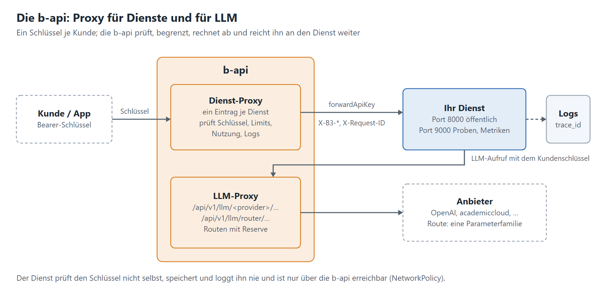

# Leitfaden: einen Dienst für die Plattform bauen

[Übergabe](README.md) · Stand 05.11.2026 · Vorlage zum Abarbeiten für Entwicklerinnen und Entwickler von Diensten,
nach den Anforderungen der Technik zur Übergabe. Jeder Block nennt, **was** zu tun ist, und ein Muster aus dem Dienst
„Kompendiale Texte“ (dieses Repository). Häkchen setzen, Rest an die Technik melden.



Die b-api hat zwei Rollen:

- **Proxy für Dienste:** Kunden rufen Ihren Dienst über die b-api auf. Die b-api prüft den Schlüssel, begrenzt die
  Nutzung, rechnet ab, protokolliert und reicht den Schlüssel an Ihren Dienst weiter.
- **Proxy für LLM:** Ihr Dienst ruft Sprachmodelle über die b-api auf, mit dem Schlüssel des Kunden. Die b-api
  wählt Anbieter und Modell, auch über Routen mit Reserve.

## 1. Dienst hinter die b-api stellen

- [ ] Eigene Prüfung des Schlüssels weglassen: die b-api authentifiziert. Dann darf der Dienst **nur** über die b-api
      erreichbar sein (NetworkPolicy oder internes Ingress, Block 4).
- [ ] Schlüssel je Anfrage lesen: `Authorization: Bearer …` bevorzugt, sonst `X-API-KEY`.
- [ ] Den Schlüssel **unverändert** in genau dem Header zurückgeben, in dem er kam – nur an die b-api, nie an andere
      Systeme.
- [ ] Nur für die Dauer der Anfrage halten: kein Cache, keine Datenbank, keine Cookies, **nie loggen** (auch nicht in
      Fehlermeldungen; Access-Log des Servers ohne Header).
- [ ] Bei einem Limit antwortet die b-api mit 401, 402, 403 oder 429: verständlich zurückgeben oder ohne LLM
      weitermachen und den Grund nennen.
- [ ] Beim Team der b-api einen **Proxy-Eintrag** beantragen: Name des Dienstes, `baseUrl` auf den öffentlichen Port,
      „API-Key des Aufrufers weiterreichen“ (`forwardApiKey`) an, Timeout = längste Anfrage + Reserve.

```python
from contextvars import ContextVar

caller_key: ContextVar[tuple[str, str] | None] = ContextVar("caller_key", default=None)


def take_key(headers) -> None:  # in einer Middleware, je Anfrage
    auth = headers.get("authorization", "")
    if auth.lower().startswith("bearer ") and len(auth) >= 23:  # ein Schlüssel hat mindestens 16 Zeichen
        caller_key.set(("Authorization", auth))
    elif headers.get("x-api-key"):
        caller_key.set(("X-API-KEY", headers["x-api-key"]))
```

Muster: `app/llm/client.py`, `app/api/b_api_key.py`; Regeln in [anforderungen.md, Abschnitt 2](anforderungen.md#2-b-api-integration-und-authentifizierung).

## 2. LLM über die b-api: Konfiguration und Routing

- [ ] Aufruf ohne Routing: `POST {B_API_BASE_URL}/api/v1/llm/<provider>/chat/completions` (etwa `openai`,
      `academiccloud`), OpenAI-kompatibler Körper, Schlüssel des Kunden im Header.
- [ ] Aufruf mit Routing: `POST …/api/v1/llm/router/chat/completions` mit dem **Routennamen** im Feld `model`.
      Eine Route bündelt Modelle nach Rang (`priorityTier`, 0 zuerst) mit Reserve; anlegen kann sie nur ein
      Administrator der b-api (global, damit alle Kundenschlüssel sie sehen).
- [ ] **Eine Route = eine Parameterfamilie.** Die b-api reicht den Körper unverändert weiter: GPT-5/6 nehmen
      `max_completion_tokens` und `reasoning_effort`, andere Modelle `max_tokens` und `temperature`. Ein Modell der
      anderen Familie als Reserve antwortet mit 400.
- [ ] Alles einstellbar über Env mit Vorgabe: Provider, Modell, Route, Basis-URL, Timeout, Parallelität.
- [ ] Ein Modell nicht für jeden Kunden voraussetzen: Wer OpenAI nicht nutzt, braucht eine Route seines Anbieters
      oder einen Betrieb ohne LLM.
- [ ] Wortgleiche Anfragen beantwortet die b-api aus einem Zwischenspeicher: für frische Antworten je Aufruf eine
      eigene Kennung mitschicken (`safety_identifier`).
- [ ] Prompt-Caching des Anbieters nutzen: gleichbleibende Teile vorn in die System-Nachricht. Kosten je Anbieter
      prüfen (Schreiben in den Cache kann extra kosten).
- [ ] Fehler der b-api unterscheiden: 400 unbekannte Route, 503 kein Modell verfügbar, 4xx/5xx des Anbieters
      (Header `X-Error-Source: upstream`).

Muster: `B_API_PROVIDER`, `B_API_MODEL`, `B_API_ROUTE`, `B_API_KEY_SOURCE` in [konfiguration.md](konfiguration.md).

## 3. Logging und Tracing (B3)

- [ ] Logs als **JSON nach stdout**, eine Zeile je Ereignis: `time` (UTC), `level`, `logger`, `message`, dazu
      `service`, `request_id`, `trace_id`, `span_id`.
- [ ] **Trace-ID übernehmen:** B3 lesen (`X-B3-TraceId`, `X-B3-SpanId`, `X-B3-Sampled`, auch `b3`) und W3C
      (`traceparent`). Kommt keine, eine neue anlegen.
- [ ] **Weitergeben:** an jeden Aufruf (b-api, andere Dienste) die B3-Header **einzeln** mit dem eigenen Span als
      Eltern-Span, dazu `X-Request-ID`. Die Antwort nennt die Spur in `X-B3-TraceId`.
- [ ] Ein Framework nutzen, keine eigenen Header bauen: OpenTelemetry mit dem B3-Propagator.
- [ ] `service` als feste Kennung des Dienstes (`OTEL_SERVICE_NAME`), damit sich seine Zeilen herausfiltern lassen.
- [ ] Proben (`/health`, `/ready`, `/metrics`) nicht tracen.
- [ ] Spans optional an einen Sammler (Jaeger) über `OTEL_EXPORTER_OTLP_ENDPOINT`; ohne ihn genügen die IDs im Log.
- [ ] Werte aus Headern prüfen (Zeichen, Länge), nie Schlüssel oder Personendaten loggen.

```python
from opentelemetry import trace
from opentelemetry.propagators.b3 import B3MultiFormat
from opentelemetry.sdk.resources import Resource
from opentelemetry.sdk.trace import TracerProvider

provider = TracerProvider(resource=Resource.create({"service.name": "mein-dienst"}))
tracer = provider.get_tracer(__name__)
B3 = B3MultiFormat()


def on_request(headers: dict[str, str]):  # Kind des Aufrufers oder neue Spur
    return tracer.start_span("POST /api/…", context=B3.extract(headers))


def outgoing(span) -> dict[str, str]:  # X-B3-TraceId, X-B3-SpanId, X-B3-Sampled
    carrier: dict[str, str] = {}
    B3.inject(carrier, context=trace.set_span_in_context(span))
    return carrier
```

Muster: `app/tracing.py`, `app/logging.py`; Felder in [betrieb.md, Abschnitt „Logs“](../betrieb.md#logs).

## 4. Ports, Proben und Metriken

- [ ] **Zwei Ports:** öffentlich (etwa 8000) nur die API; intern (etwa 9000) `/health`, `/ready`, `/metrics`.
- [ ] Ingress und b-api zeigen **nur** auf den öffentlichen Port.
- [ ] `/health` (Liveness): lebt der Prozess. `/ready` (Readiness): kann er antworten (Daten geladen, Abhängigkeiten
      da). Beide schnell, ohne Schlüssel.
- [ ] `/metrics` im Prometheus-Format: Anfragen, Dauer, Fehler, LLM-Tokens; optional mit eigenem Token.
- [ ] Alarmregeln mit dem Dienst ausliefern (`PrometheusRule`), mit Tests.
- [ ] NetworkPolicy: öffentlicher Port nur aus dem Namespace der b-api, interner nur aus dem Monitoring; ausgehend nur
      DNS und was der Dienst braucht.

Muster: `PUBLIC_PORT`, `INTERNAL_PORT`, `monitoring/alerts.yml`; [betrieb.md, „Erreichbarkeit“](../betrieb.md#erreichbarkeit).

## 5. Helm-Chart je Tag

- [ ] Chart im Repository (`deploy/helm/<dienst>`), `version` = `appVersion` = Version des Dienstes.
- [ ] Die CI prüft (`helm lint`, `helm template`, kubeconform) und veröffentlicht zu jedem Tag `vX.Y.Z` das Image und
      das Chart in derselben Version (OCI-Registry).
- [ ] `values.yaml` mit Kommentar je Wert (`## @param …`): Image, Ressourcen, Proben, Ingress mit Beispiel-Host,
      Secrets, NetworkPolicy, Volumes, ServiceMonitor, PrometheusRule.
- [ ] Sicherheit nach Pod Security „restricted“: nicht root, nur lesendes Dateisystem, keine Capabilities,
      `seccompProfile: RuntimeDefault`, beschreibbar nur `emptyDir`.
- [ ] Ressourcen gemessen statt geschätzt (Request und Limit); sagen, ob der Speicher fest ist oder mit der Last
      wächst.
- [ ] Hintergrundarbeit (Updates von Daten) als **CronJobs**, gestaffelt nachts, `concurrencyPolicy: Forbid`; der
      Lauf beendet sich sauber bei SIGTERM.
- [ ] `imagePullSecrets` vorsehen, falls die Registry nicht öffentlich ist; das Paket nach dem ersten Push prüfen.
- [ ] Docker Compose für einen einzelnen Host weiter pflegen, mit demselben Image.

Muster: [deploy/helm/compendious-text-generator](../../deploy/helm/compendious-text-generator/), Job `chart` in
`.github/workflows/ci.yml`.

## 6. Image und Konfiguration

- [ ] Image klein halten: mehrstufig bauen, `.dockerignore`, keine Testdaten; große Daten auf Volumes.
- [ ] Jede Einstellung als Env-Variable mit Vorgabe; eine Vorlage `.env.example`; Secrets nur aus Secrets.
- [ ] Der Dienst läuft auch ohne optionale Teile (LLM, Repository, Sammler) und sagt, was fehlt.
- [ ] Generisch bleiben: WLO ist nicht jedes edu-sharing; Eingaben möglichst auch als Text statt als Knoten-ID.

## 7. Unterlagen zur Übergabe

- [ ] Steckbrief (eine Seite): Zweck, Funktionen mit **Laufzeit und Kosten**, Ports, b-api, Ressourcen, offene Punkte;
      Owner **und Vertretung**.
- [ ] OpenAPI unter `/docs` mit Beispielen und Erklärung jedes Parameters.
- [ ] Mit wem der Dienst spricht (für die NetworkPolicy) und welche Rechte er dort braucht.
- [ ] Changelog und Hinweise für Updates; Abhängigkeiten aktuell halten (Dependabot oder Renovate).

Muster: [Steckbrief](steckbrief.md), [Antworten für das IT-Team](anforderungen.md).
