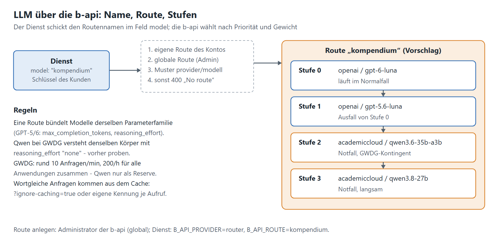

# 2.1 LLM und Routing über die b-api

[Leitfaden](../leitfaden-dienste.md) · zurück: [1. API](01-api.md) · weiter: [2.2 Dienst hinter der b-api](02-2-dienst-hinter-b-api.md)

## So funktioniert es

- Der Dienst ruft `POST {B_API_BASE_URL}/api/v1/llm/router/chat/completions` (OpenAI-kompatibel) und schickt den
  **Routennamen** im Feld `model`, mit dem Schlüssel des Kunden (Kapitel 2.2).
- Die b-api löst den Namen in dieser Reihenfolge auf: eigene Route des Kontos → globale Route → Muster
  `provider/modell` (etwa `openai/gpt-6-luna`, ohne Reserve) → sonst **400** „No route configured“.
- Eine Route wählt nach **Priorität** (0 zuerst) und innerhalb einer Priorität nach **Gewicht** (ganze Zahlen ab 1).
  Antwortet ein Modell nicht, weicht sie auf das nächste aus.
- Globale Routen legt ein **Administrator der b-api** an (Seite „LLM-Routing“); sie gelten für alle Konten. Eigene
  Routen gelten nur für die Schlüssel eines Kontos und gehen dort vor.
- Welches Modell geantwortet hat, steht nur im Feld `model` der Antwort.

## Regeln

- [ ] **Eine Parameterfamilie je Route.** Die b-api reicht den Körper unverändert weiter. GPT-5/6 nehmen
      `max_completion_tokens`, `reasoning_effort` und keine eigene `temperature`; gpt-4o und viele GWDG-Modelle
      `max_tokens`. Eine gemischte Route scheitert immer an einem Modell mit 400.
- [ ] **Erst die Route, dann die Anwendung.** Wer nur die Adresse auf `/router/` umstellt und weiter einen
      Modellnamen schickt, bekommt sofort 400.
- [ ] **Modelle nur innerhalb ihrer Familie tauschen**, beim Speichern „Cache leeren“ (`clearCache: true`).
- [ ] **Alles per Env:** `B_API_BASE_URL`, Provider bzw. `router`, Route, Timeout, Parallelität – mit Vorgaben.
- [ ] **`LLM_ROUTE_MANAGE` nie im Schlüssel einer Anwendung**, nur in Verwaltungsschlüsseln.

## Praxiswissen

- **Cache:** Wortgleiche Anfragen kommen aus dem Cache der b-api – gleiche `id`, gleiche Tokens, ohne Kennzeichen.
  Wer bewusst neu fragt (Varianten, Messungen), hängt `?ignore-caching=true` an oder macht den Körper je Aufruf
  eindeutig (der Kompendium-Dienst schickt eine eigene Kennung `safety_identifier` je Aufruf).
- **Prompt-Caching des Anbieters:** Gleichbleibende Teile (Kataloge, Anweisungen) vorn in die System-Nachricht;
  OpenAI rechnet gecachte Eingabe günstiger ab. Bei Anbietern mit Aufschlag für das Schreiben in den Cache
  (Anthropic +25 %) neu rechnen.
- **Dauerfehler kommen als 503:** fehlender Preis („Model pricing unavailable“), keine aktive Stufe, ein Modell am
  falschen Endpunkt. Erst die Meldung lesen, nicht blind wiederholen. Fehler des Anbieters: 502 mit
  `X-Upstream-Status`.
- **Streaming bricht nach 30 s ab** (ohne `finish_reason`); lange Antworten ohne Streaming abrufen.
- **GWDG (AcademicCloud):** Alle Anwendungen hinter der b-api teilen sich ein Kontingent von **rund 10 Anfragen je
  Minute und 200 je Stunde**. Ist es aufgebraucht, steht jede AcademicCloud-Route still; Ausweichen innerhalb der
  GWDG hilft nicht. `status` und `demand` der Modellliste taugen nicht als Gesundheitsprüfung.
- **Ein Körper für beide Familien:** `max_completion_tokens` plus `reasoning_effort: "none"` verstehen gpt-6-luna und
  die Qwen-Modelle der GWDG; Qwen denkt dann nicht. Mit `"low"` denkt Qwen trotzdem (langsam). Ein Dienst, der
  gemischte Routen nutzt, muss genau diesen Körper schicken – vorher proben.
- **Rückfall statt Abbruch:** Lehnt die b-api ab (401, 402, 403, 429), lieber ohne LLM weiterarbeiten und den Grund
  nennen, als den Aufruf scheitern zu lassen.

## Standardrouten (Empfehlung)

Nach der Auswertung vom 09.10.2026 (Modelle der GWDG, Benchmarks, eigene Tests). Regeln: Modelle einer Stufe ähnlich in
Qualität und Tempo, Spezialmodelle (Coder) außen vor, GWDG wegen des Kontingents nur dort, wo wenige Aufrufe anfallen.

| Route | Stufe 0 | Reserve | Wofür |
|---|---|---|---|
| `schnell-guenstig` | `qwen3.6-35b-a3b` (Gewicht 2), `qwen3-30b-a3b-instruct-2507` | `qwen3.8-27b` | viele einfache Fragen, Daten bleiben in Göttingen; nur mit höherer GWDG-Quote produktiv |
| `schnell-guenstig-openai` | `gpt-6-luna` | `gpt-5.6-luna`, `gpt-5.4-nano` | dasselbe auf OpenAI, ohne Drosselung |
| `agentisch` | `qwen3.5-397b-a17b` (Gewicht 2), `qwen3.6-35b-a3b` | `qwen3.8-27b` | Tool-Calling, mehrstufige Abläufe; ohne Streaming |
| `kompendium` | `gpt-6-luna` | 1: `gpt-5.6-luna` · 2: `qwen3.6-35b-a3b` · 3: `qwen3.8-27b` | Kompendiale Texte: läuft auf gpt-6-luna, Qwen nur im Notfall |

Die Route `kompendium` liegt fertig zum Anlegen in [`deploy/b-api/route-kompendium.json`](../../../deploy/b-api/route-kompendium.json).
Im Dienst dann `B_API_PROVIDER=router` und `B_API_ROUTE=kompendium`. Vorbehalt für die Stufen 2 und 3: Der Dienst
schickt GPT-Parameter (`reasoning_effort` meist `low`, dazu `verbosity`); ob die GWDG-Modelle sie annehmen und schnell
genug antworten, ist nicht geprobt. Ein Kompendium stellt im Standard rund 20 LLM-Aufrufe (M75) – das GWDG-Kontingent
reicht damit nicht einmal für ein Kompendium je Minute.

Quellen: [GWDG Chat AI, Modelle](https://docs.hpc.gwdg.de/services/ai-services/chat-ai/models/index.html) ·
[GWDG SAIA (API)](https://docs.hpc.gwdg.de/services/ai-services/saia/index.html) ·
[GWDG Token-Preise](https://docs.ai.gwdg.de/procurement/token-price/index.html) ·
[OpenAI Preise](https://developers.openai.com/api/docs/pricing). Limits der GWDG ändern sich; vor dem Anlegen einer
Route den aktuellen Stand prüfen.

## Fehlermeldungen der b-api

| Status | Meldung | Tun |
|---|---|---|
| 400 | `No route configured for model 'x'` | Namen prüfen (`GET …/router/models`) oder `provider/modell` |
| 400 | `Unsupported parameter: 'max_tokens' …` | Parameter zur Modellfamilie passend schicken |
| 401 | leer | Schlüssel fehlt, falsch oder `bearer` klein |
| 503 | `Model pricing unavailable …` | Modellname prüfen; nicht wiederholen |
| 503 | `No deployment could serve model 'x'` | Stufen der Route prüfen; nur bei kurzem Ausfall wiederholen |
| 502 | mit `X-Upstream-Status` 429 oder 500 | Fehler beim Anbieter; Route mit Reserve nutzen |

Muster: `app/llm/client.py` (Parameterfamilie, Kennung je Aufruf, Rückfall), `B_API_*` in [konfiguration.md](../konfiguration.md).
