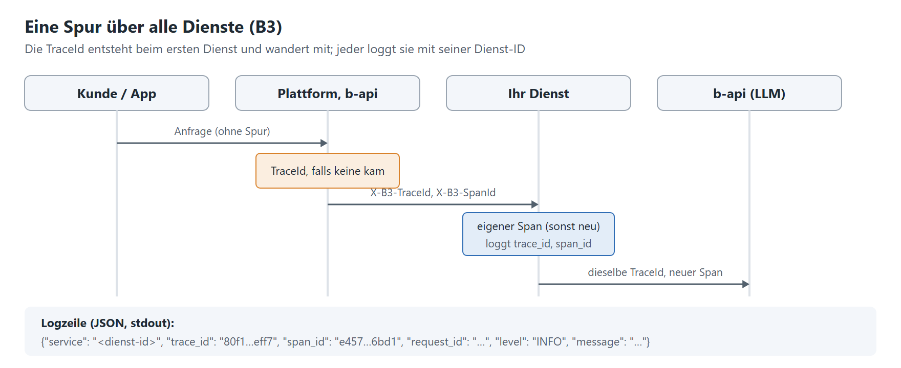

# 2.3 Logging und Tracing

[Leitfaden](../leitfaden-dienste.md) · zurück: [2.2 Dienst hinter der b-api](02-2-dienst-hinter-b-api.md) · weiter: [3. Betrieb](03-betrieb.md)



## Vorgaben

- [ ] **Logs nach stdout**, nicht in Dateien im Container.
- [ ] **JSON-Format** (umschaltbar auf Klartext für die Entwicklung), Level per Env-Variable.
- [ ] **B3-konform:** Die Trace-ID kommt mit der Anfrage und wird mit ihr geloggt. Kommt keine, legt sie der erste
      Dienst an.
- [ ] **Ein Framework** schreibt die Header, je Wert ein eigener: `X-B3-TraceId`, `X-B3-SpanId`, `X-B3-Sampled`.
- [ ] **`x-client-trace-id`** unverändert weiterreichen.
- [ ] **Dienst-ID** in jeder Zeile, damit der Betrieb die Zeilen des Dienstes herausfiltert.

## Umsetzung

| Schritt | Wie |
|---|---|
| Lesen | B3 (`X-B3-*` und `b3`) und W3C (`traceparent`) aus der Anfrage; B3 geht vor |
| Span | je Anfrage ein Span als Kind des Aufrufers, sonst eine neue Spur (OpenTelemetry SDK) |
| Weitergeben | an jeden Aufruf (b-api, andere Dienste) `X-B3-TraceId`, `X-B3-SpanId`, `X-B3-Sampled` und `traceparent` mit dem eigenen Span; dazu `X-Request-ID` |
| Antwort | die Spur in `X-B3-TraceId`, damit Aufrufer sie bei Rückfragen nennen |
| Loggen | `time` (UTC), `level`, `logger`, `message`, `service`, `request_id`, `trace_id`, `span_id`, ggf. `client_trace_id` |
| Proben | `/health`, `/ready`, `/metrics` nicht tracen |
| Export | Spans optional an einen Sammler (Jaeger) über `OTEL_EXPORTER_OTLP_ENDPOINT`; ohne ihn genügen die IDs im Log |

```python
from opentelemetry import trace
from opentelemetry.propagators.b3 import B3MultiFormat
from opentelemetry.sdk.resources import Resource
from opentelemetry.sdk.trace import TracerProvider

provider = TracerProvider(resource=Resource.create({"service.name": "mein-dienst"}))  # die Dienst-ID
tracer = provider.get_tracer(__name__)
B3 = B3MultiFormat()


def on_request(headers: dict[str, str]):  # Kind des Aufrufers oder neue Spur
    return tracer.start_span("POST /api/…", context=B3.extract(headers))


def outgoing(span) -> dict[str, str]:  # X-B3-TraceId, X-B3-SpanId, X-B3-Sampled
    carrier: dict[str, str] = {}
    B3.inject(carrier, context=trace.set_span_in_context(span))
    return carrier
```

```json
{"time": "2026-11-05T09:12:03.120Z", "level": "INFO", "service": "mein-dienst", "request_id": "c1f…",
 "trace_id": "80f198ee56343ba864fe8b2a57d3eff7", "span_id": "e457b5a2e4d86bd1", "message": "POST /api/x 200 812 ms"}
```

## Praxiswissen

- **Eine Spur gewinnt:** Kommen B3 und W3C mit verschiedenen IDs oder nur `X-B3-TraceId` ohne Span-ID, sonst laufen
  geloggte und weitergegebene ID auseinander. Die B3-ID der Spur zählt.
- **64-Bit-IDs** (16 Zeichen) so loggen und weitergeben, wie sie kamen; sonst findet der Filter sie nicht.
- **Fehlendes `X-B3-Sampled`** heißt „aufgeschoben“, nicht „nein“: der eigene Sampler entscheidet.
- **Werte prüfen:** Header-Werte mit fremden Zeichen oder über 256 Zeichen verwerfen, nicht ändern; nie Schlüssel,
  Tokens oder Personendaten loggen.
- **Auch die Zeilen des Servers** (uvicorn: Start, Stopp, ein beendeter Worker) und von Warnungen im selben Format.
- **Eine Zeile je Anfrage** mit Methode, Pfad, Route, Status, Dauer – ohne Header.

Muster: `app/tracing.py`, `app/logging.py`; Felder in [betrieb.md, „Logs“](../../betrieb.md#logs).
