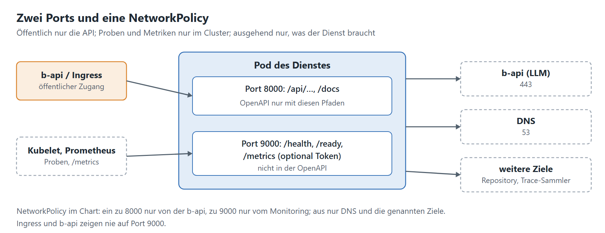

# 3. Betrieb

[Leitfaden](../leitfaden-dienste.md) · zurück: [2.3 Logging und Tracing](02-3-logging-tracing.md) · weiter: [4. Build und Helm](04-build-helm.md)

## Ports, Proben, Metriken

- [ ] **Zwei Ports:** öffentlich nur die API (über b-api oder Ingress); intern `/health` (Liveness), `/ready`
      (Readiness), `/metrics` (Prometheus). Geht das nicht, die auszublendenden Pfade benennen.
- [ ] **Metriken** über die Prometheus-Bibliothek des Frameworks, nur am internen Port; Applikationsmetriken legt T4
      je Dienst fest (Warteschlange, Dauer, Fehlerrate der LLM-Aufrufe, Tokens).
- [ ] **Alarmregeln** über den Ready-Check hinaus im Helm-Chart mitliefern, mit Tests (`promtool test rules`).
- [ ] **NetworkPolicy:** ein nur von der b-api (öffentlicher Port) und vom Monitoring (interner Port); aus nur DNS
      und was der Dienst braucht. Eine NetworkPolicy kennt keine Hostnamen: Ziele per `ipBlock` oder FQDN-Regeln des
      CNI begrenzen.

## Zustand und Skalierung

- [ ] **Zustandslos:** Jeder Pod beantwortet jede Anfrage. Zustand (Sessions, Jobs, Historien) in eine Datenbank oder
      einen Cache außerhalb des Pods.
- [ ] **Hintergrundaufgaben** über eine Warteschlange mit eigenen Worker-Pods, oder als CronJob (unten).
- [ ] **Datenbank:** PostgreSQL (relational), MongoDB (Dokumente), Redis (Cache, Warteschlange, Locks). **SQLite** nur
      für die Entwicklung oder rein lesende, mitgelieferte Daten. Zugang vollständig per Env; im Chart abschaltbar
      (`postgresql.enabled: false` plus Verbindung zu einer externen Instanz).
- [ ] **Grenzen nennen:** was mehrere Pods können, was nicht (Einzel-Worker, Locks, Rate-Limits externer APIs).

## Ressourcen

- [ ] **Messen statt schätzen:** RAM und CPU unter realistischer Last (`docker stats` oder die cgroup des Containers),
      Leerlauf, warm, Spitze. Großen Speicher durch Modelle gesondert ausweisen.
- [ ] **Fest oder elastisch?** Angeben, ob der Speicher mit der Last wächst, und Request und Limit mit Puffer
      empfehlen (Limit ≈ gemessene Spitze + 20 bis 30 %).
- [ ] **Grenzen im Container:** Kubernetes setzt Request und Limit für den Container; der Kernel setzt sie durch
      (Speicher über dem Limit: OOMKill, CPU darüber: Drosselung). Innerhalb des Containers ist nichts zusätzlich zu
      begrenzen – aber der Dienst muss so eingestellt sein, dass er hineinpasst:
  - **Worker-Zahl** (`WEB_CONCURRENCY`, Gunicorn/Uvicorn-Worker) × Speicher je Worker + Grundbedarf ≤ Limit.
  - **Threads von numpy/BLAS** (OpenBLAS, MKL) richten sich nach den Kernen des Knotens, nicht nach dem CPU-Limit:
    `OMP_NUM_THREADS`, `OPENBLAS_NUM_THREADS` passend setzen und unter Last messen.
  - **Eigene Pools** (Threads, parallele LLM-Aufrufe) und Caches mit festen Obergrenzen.
  - Dienste wie Redis oder eine JVM brauchen ihre Grenze ausdrücklich (`maxmemory`, `-Xmx`); Python liest das
    Limit nicht selbst.

## Große Daten

- [ ] Modelle, Indizes, Korpora **nicht ins Image**: herunterladbar bereitstellen, über einen PVC einbinden, befüllt
      von einem Init-Container, Sidecar oder CronJob. Mehrere Pods teilen das Volume (ReadWriteMany oder nur lesend).
- [ ] **Volume-Größe** und erwartetes Wachstum angeben.

## Updates der Daten

- [ ] Als **CronJobs** im Helm-Chart, **gestaffelt nachts** (keine zwei zugleich), `concurrencyPolicy: Forbid`,
      eigene Ressourcen je Job; ein Lauf darf nachts mehr bekommen.
- [ ] Ein Image mit **mehreren Modi** (API, Updater per Kommandozeile) statt mehrerer Images.
- [ ] Der Lauf ist PID 1: **SIGTERM abfangen**, Status schreiben, Sperre freigeben.
- [ ] **Überwachen:** Alarm, wenn seit dem letzten Termin kein Lauf gelang; Stand der Daten in `/health`.

## Praxis aus „Kompendiale Texte“

- RAM weitgehend fest: 3,3 GiB nach Start, 4,0 GiB warm, unter Last +0,2 GiB (2 Worker); je Worker rund 2 GiB.
  Empfehlung Request 5 Gi, Limit 6 Gi. Mehr CPU je Worker hilft nicht (Interpreter-Sperre); skaliert wird über Worker
  und Pods.
- SQLite-Indexe nur lesend, als lokale Kopie je Pod im `emptyDir` (`INDEX_COPY_DIR`); die Volumes hängt die API nur
  lesend ein; nur die Updater schreiben, je genau einer.
- Vier Updater als CronJobs: GND 01:15 und Wikidata 02:15 täglich, Lehrpläne 03:15 und Kiwix 04:15 sonntags.

Muster: [Steckbrief](../steckbrief.md), [README der Übergabe, Lastmessung](../README.md#lastmessung-vom-16102026).
