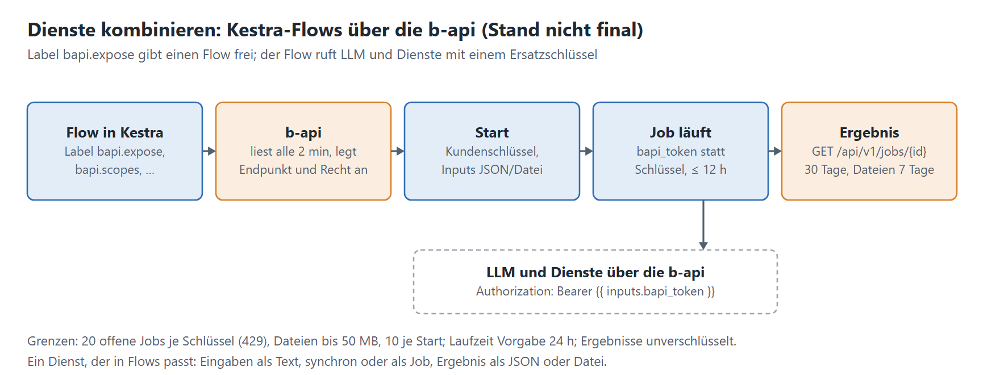

# 5. Dienste kombinieren: Kestra-Flows über die b-api

[Leitfaden](../leitfaden-dienste.md) · zurück: [4. Build und Helm](04-build-helm.md) · weiter: [6. Übergabe](06-uebergabe.md)

> **Stand noch nicht final.** Die Regeln folgen dem Dokument „Flows für die B-API“; Einzelheiten (Pfad des
> Start-Endpunkts, Laufzeit über 12 Stunden) sind offen.



## So funktioniert es

- Ein Flow wird in **Kestra** geschrieben und über **Labels** für die b-api freigegeben. Die b-api liest solche Flows
  alle 2 Minuten, legt das Recht `JOB_RUN_<NAMESPACE>_<FLOWID>` an und erzeugt Endpunkt und API-Doku aus den Inputs.
- Ein Kunde startet den Flow mit seinem Schlüssel (Inputs als JSON, Dateien als `multipart/form-data`) und holt das
  Ergebnis ab: `GET /api/v1/jobs/{jobId}` → Status, deklarierte Outputs, Dateien mit Download-Link.

| Label | Wert | Wirkung |
|---|---|---|
| `bapi.expose` | `"true"` | Flow wird angeboten; ohne Label verschwindet er wieder |
| `bapi.scopes` | `llm`, `edu-sharing-llm` | wofür das Ersatz-Token gilt; nur zusammen mit dem Input `bapi_token` |
| `bapi.maxRuntime` | ISO-8601, etwa `PT30M` | höchste Laufzeit (Vorgabe 24 h); danach Abbruch mit `TIMEOUT` |

- **Ersatz-Token `bapi_token`** (Input vom Typ `SECRET`): Die b-api erzeugt je Job ein Token `bjt_…`; der echte
  Schlüssel des Kunden gelangt nie zu Kestra. Im Flow: `Authorization: Bearer {{ inputs.bapi_token }}`. Kosten und
  Kontingent laufen auf den Schlüssel des Kunden. Das Token gilt nur für die Scopes, endet mit dem Job, höchstens 12 h.
- Andere Inputs mit `bapi_` sind reserviert; `SECRET`, `FORM`, `YAML` lassen sich über die API nicht füllen.
- **Grenzen:** 20 offene Jobs je Schlüssel (danach 429 mit `Retry-After`); Dateien bis 50 MB, 10 je Start, 100 MB
  zusammen; Jobs 30 Tage, Dateien 7 Tage abrufbar; Outputs stehen unverschlüsselt in Kestra – keine Geheimnisse darin.

## Was ein Dienst dafür mitbringt

- [ ] **Eingaben als Text** (Kapitel 1): Ein Flow reicht Texte und Dateien weiter, keine Sitzung eines Repositorys.
- [ ] **Ergebnis als JSON** oder als Datei; Felder, die ein nächster Schritt direkt weiterverwenden kann.
- [ ] **Über die b-api erreichbar** (Proxy-Eintrag, Kapitel 2.2) und mit dem Token des Flows aufrufbar; ob Flows
      Proxy-Pfade aufrufen dürfen, hängt an den Scopes – mit dem Team der b-api klären.
- [ ] **Laufzeit kennen:** synchron bis etwa 30 s, länger als eigener Job; `bapi.maxRuntime` danach setzen.
- [ ] **Trace weitergeben:** dieselben B3-Header, damit ein Flow über alle Dienste verfolgbar bleibt.

```yaml
id: beispiel-flow
namespace: meine.firma
labels:
  bapi.expose: "true"
  bapi.scopes: "llm"
  bapi.maxRuntime: "PT2H"
inputs:
  - id: bapi_token
    type: SECRET
  - id: thema
    type: STRING
    description: Thema des Textes
    required: true
tasks:
  - id: text
    type: io.kestra.plugin.core.http.Request
    uri: "https://<b-api-host>/api/v1/llm/router/chat/completions"
    method: POST
    headers:
      Authorization: "Bearer {{ inputs.bapi_token }}"
    body: '{"model": "<route>", "messages": [{"role": "user", "content": "{{ inputs.thema }}"}]}'
outputs:
  - id: antwort
    type: STRING
    value: "{{ outputs.text.body }}"
```

Warum ein Flow nicht angeboten wird, steht in der b-api auf der Seite „Flows“ unter „Letzter Sync“.
