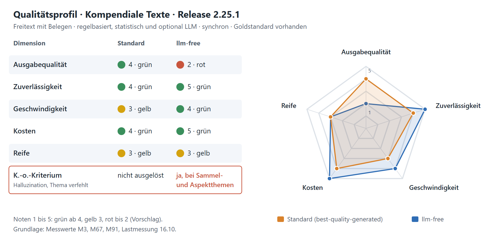
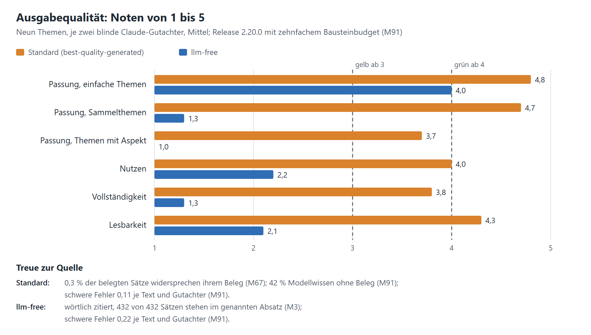
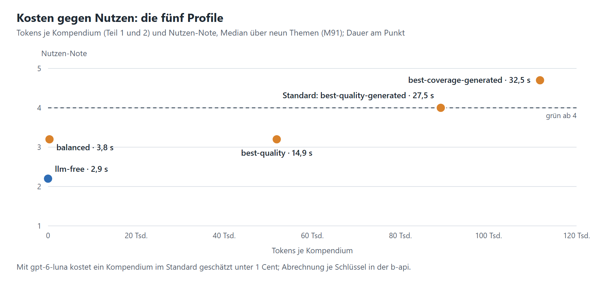
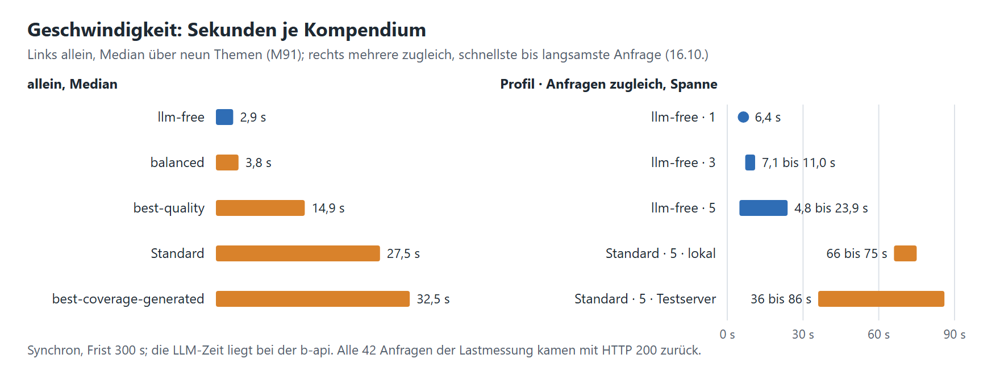

# Qualitätsprofil: Kompendiale Texte

[Übergabe](README.md) · Stand 03.11.2026 · Messwerte bis Release 2.25.1 · nach dem Raster „Qualität metadatengenerierender Dienste“
(Merkmale, Prüfmodule, fünf Dimensionen, Scorecard). Alle Kennzahlen sind gemessen, mit Quelle im
[Messprotokoll](../entwicklung/05-messprotokoll.md) oder in der [Lastmessung](README.md#lastmessung-vom-16102026).
Die Noten und Ampeln sind ein Vorschlag nach den [Schwellen](#schwellen-vorschlag) unten.

Bewertet werden zwei Profile: **Standard** (`best-quality-generated`, die Vorgabe mit LLM, D82) und **`llm-free`**
(ohne LLM, wörtlich aus Wikipedia und Klexikon). Die drei übrigen Profile stehen in den Detailgrafiken.

## Scorecard

| Dimension | Standard | `llm-free` | Kennzahlen | Quelle |
|---|---|---|---|---|
| Ausgabequalität | 🟢 4 | 🔴 2 | Gutachternoten 1–5 (Passung, Nutzen, Vollständigkeit, Lesbarkeit) im Mittel 4,1 und 1,9; widersprechende Belege 0,3 %; schwere Fehler 0,11 und 0,22 je Text und Gutachter | M91, M67 |
| Zuverlässigkeit | 🟢 4 | 🟢 5 | 42 von 42 Anfragen unter Last mit HTTP 200; kein Rückfall in M91; `llm-free` liefert bei gleichem Archivstand denselben Text, ab `balanced` wechselt der Korpus je Lauf | Last 16.10., M91, D63 |
| Geschwindigkeit | 🟡 3 | 🟢 4 | allein im Median 27,5 und 2,9 s; fünf zugleich bis 86 und bis 24 s (Testserver 26,5 s) | M91, Last 16.10. |
| Kosten | 🟢 4 | 🟢 5 | Standard rund 89.000 Tokens je Kompendium, geschätzt unter 1 Cent; `llm-free` 0 Tokens; keine Kosten externer APIs | M91, Steckbrief |
| Reife | 🟡 3 | 🟡 3 | Audit 16.10.: 83 von 100, produktionsreif unter Bedingungen (erfüllt mit 2.24.0); 3.309 Tests, 96,9 % Abdeckung; Übergabeprüfung läuft, ein kritischer offener Punkt bei der b-api | Audit, CI 02.11. |
| **K.-o.-Kriterium** | nicht ausgelöst | **ausgelöst bei Sammel- und Aspektthemen** | Halluzination: 0,3 % Widersprüche; Modellwissen auf Wunsch markiert (D76). Thema verfehlt: `llm-free` hat Passung 1,3 bei Sammelthemen und 1,0 bei Themen mit Aspekt (falscher Hauptartikel) | M67, M91 |

Merkmale: Freitext mit Belegen · regelbasiert, statistisch und optional LLM · synchron · Goldstandard vorhanden.

**Stärken:** jeder wörtliche Satz mit Beleg, prüfbar über Belegnummer und Audit je Anfrage; fünf Profile entlang
Qualität, Zeit und Kosten wählbar; keine externen Kosten; stabil unter Last.

**Größte Lücke:** Die Ausgabequalität haben nur Claude-Gutachter bewertet, gegen einen Goldstandard, den Claude
vorgeschlagen hat und den die Redaktion noch nicht geprüft hat. Es gibt keine laufende Messung, ob die Qualität
nach einem Modell- oder Archivwechsel sinkt.

**Nächster Schritt:** eine redaktionelle Stichprobe mit dem Raster aus M91 (etwa neun Themen im Standard); der Gold-
und Gutachterlauf als wiederkehrender Regressionstest bei jedem Modell- oder Archivwechsel; der offene Punkt der
b-api (Proxy-Eintrag, Timeout ≥ 330 s).

## Merkmale

| Merkmal | | Ausprägung |
|---|---|---|
| Freitext | ● | ein Kompendium als Markdown in Bausteinen der Vorlage |
| Transformierter Inhalt | ● | `llm-free`, `balanced`, `best-quality`: Absätze wörtlich aus den Archiven, mit Belegnummer |
| Struktur | ◐ | feste Bausteine der Vorlage, keine eigene Hierarchie |
| Wert aus Vokabular | ◐ | Lehrplanbezüge aus MEM, Entitäten mit Wikidata- und GND-Kennung |
| Regelbasiert und statistisch | ● | Artikelwahl, BM25, Zeichen-n-Gramme, Model2Vec |
| LLM | ◐ | optional; der Standard nutzt es, `llm-free` nicht |
| Echtzeit | ● | synchron, Frist 300 s |
| Batch | ○ | keine Job-Endpunkte |
| Goldstandard | ● | Zuordnung (10 Themen, 643 Absätze), Artikelwahl (94 Anfragen) |

● trifft zu · ◐ teilweise · ○ trifft nicht zu

## Prüfmodule

| Prüfmodul | Kenngröße | Stand | Quelle |
|---|---|---|---|
| Goldset-Vergleich | macro-F1 der Zuordnung; Hauptartikel richtig | 0,455 (`llm-free`), 0,661 bis 0,675 (LLM-Zuordnung); 87 und 91 von 94 | M82 |
| Treue zur Quelle | Sätze im zitierten Absatz; Widerspruch zum Beleg | 432 von 432 (`llm-free`); 0,3 % Widerspruch, 1,6 bis 3,1 % nicht gedeckt (Standard) | M3, M67 |
| Gutachter mit Rubrik | Passung, Nutzen, Vollständigkeit, Lesbarkeit 1–5 | zwei blinde Claude-Gutachter, gleiche Note bei Passung in 39 von 45 Fällen; **Human-Check fehlt** | M91 |
| Werte aus Vokabular | Lehrplanelemente passend; Kennungen der Entitäten | 70 bis 81 % und 74 bis 79 %; Wikidata-Präzision 0,29 (`llm-free`) und 0,70 | M32, M43 |
| Wiederholungstest | gleicher Text bei gleicher Eingabe | `llm-free` ja; ab `balanced` wechselt der Korpus, die Streuung der Noten ist **nicht gemessen** | D63, M86 |
| Regressionstest / Drift | Kennzahlen über die Zeit | CI mit 3.309 Tests und 96,9 % Abdeckung; Gold und Gutachter nur bei Messungen, **nicht laufend** | CI, Audit 16.10. |
| Lasttest | Dauer, Fehler, Speicher bei Parallelität | 42 von 42 mit HTTP 200; 4,02 GiB warm, Spitze 3,4 Kerne | Last 16.10. |
| Kostenrechnung | Tokens je Kompendium, Cache | Tokens je Profil gemessen, je Anfrage im Audit; Euro nur geschätzt | M91, M46 |
| Kalibrierung | Konfidenz gegen Trefferquote | nicht anwendbar | – |

## Detail

## Schwellen (Vorschlag)

Ampel: 4 und 5 grün, 3 gelb, 1 und 2 rot. Die Noten entstehen so:

| Dimension | 5 | 4 | 3 | 2 |
|---|---|---|---|---|
| Ausgabequalität | Mittel der vier Gutachternoten ≥ 4,5 | ≥ 3,5 | ≥ 2,5 | ≥ 1,5 |
| Zuverlässigkeit | keine Fehler unter Last, gleiche Ausgabe bei gleicher Eingabe | keine Fehler unter Last, Ausgabe variiert je Lauf | einzelne Fehler oder Rückfälle | häufige Fehler |
| Geschwindigkeit: Median allein / langsamste von fünf zugleich | ≤ 5 s / ≤ 15 s | ≤ 10 s / ≤ 30 s | ≤ 30 s / ≤ 120 s | ≤ 60 s / ≤ 300 s |
| Kosten je Kompendium | keine LLM-Tokens | unter 1 Cent | unter 5 Cent | mehr |
| Reife | im Zielbetrieb nachgewiesen, nichts Kritisches offen | produktionsreif laut Audit, nichts Kritisches offen | wie 4, aber ein kritischer Punkt offen | ohne Audit |

K.-o.: Mehr als 1 % der belegten Sätze widerspricht seinem Beleg, oder die Passung zum angefragten Thema liegt in einer
Themenart unter 2. Ein K.-o. gilt für den Einsatz, den es trifft; `llm-free` bleibt für einfache Themen brauchbar
(Passung 4,0).

Offen zur Entscheidung: die Schwellen selbst, die Gewichtung der Dimensionen und ob die Redaktion die Gutachternoten
ersetzt oder ergänzt.

Grafiken: `qualitaetsprofil.py` zeichnet sie als SVG nach `bilder/`; die PNG-Fassungen zum Einfügen in Confluence
entstehen daraus mit doppelter Auflösung.
