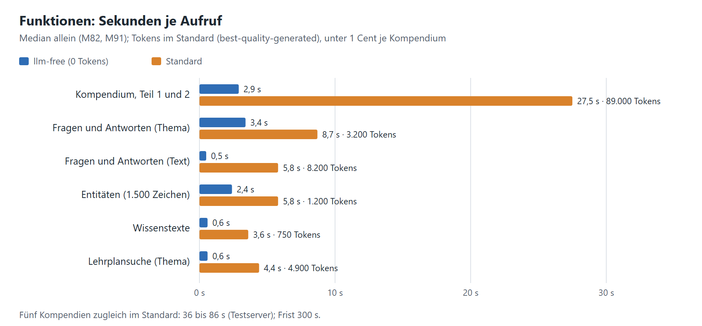
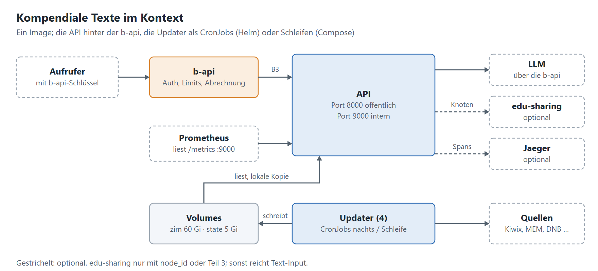

# Technischer Service-Steckbrief

[Übergabe](README.md) · Stand 05.11.2026 · Release 2.26.0 · Vorlage „Technischer Service-Steckbrief“ von Team 6.
Ausführlich: [Antworten für das IT-Team](anforderungen.md), [Leitfaden für Dienste](leitfaden-dienste.md).

| | |
|---|---|
| **Service** | Kompendiale Texte (`compendious-text-generator`) |
| **Technischer Owner** | Jan Schachtschabel · Vertretung: *offen* |
| **Readiness Status** | Übergabeprüfung |
| **Offene Punkte** | 6 |
| **Kritische Offene Punkte** | 1 |
| **Jira** | [GEN-323](https://edu-sharing.atlassian.net/browse/GEN-323) & [GEN-346](https://edu-sharing.atlassian.net/browse/GEN-346) |

## Stammdaten & API

| | | Status |
|---|---|---|
| Anzeigename und Beschreibung | „Kompendiale Texte“: belegter Sachtext zu einem Thema (Teil 1), Lehrplanbezüge (Teil 2), Sammlungsüberblick (Teil 3); dazu QA-Paare, Entitäten, Wissenstexte | erfüllt |
| Repository-Link | GitLab (Produktion): `scm.edu-sharing.com/edu-sharing/projects/wlo/compendious-text-generator` · GitHub (Entwicklung): [compendius-textgenerator-sc26](https://github.com/janschachtschabel/compendius-textgenerator-sc26) | erfüllt |
| OpenAPI Spec | `GET /openapi.json`, lesbar unter `/docs`, Beispiele je Endpunkt | erfüllt |
| Pipeline und Git-Tags | Tag `vX.Y.Z` → Image `:X.Y.Z` und Helm-Chart `X.Y.Z` (GitHub Actions); aktuell `v2.26.0` | erfüllt |
| Endpunkte | Port **8000**: `/api/v2/…`, `/docs` · Port **9000**: `/health`, `/ready`, `/metrics` | erfüllt |
| Header und Content-Types | Ein: `Authorization: Bearer`, B3 (`X-B3-*`), `traceparent` · Aus: `X-Request-ID`, `X-B3-TraceId` · nur JSON | erfüllt |
| Asynchrone Job-Endpunkte | keine; synchron, Frist 300 s, Proxy-Timeout ≥ 330 s | nicht anwendbar |
| Funktionen, Laufzeit, Kosten | siehe Grafik; Eingabe auch ohne Repository als Text (`material`, `collection_context`, `sources`) | erfüllt |

## Architektur

| | | Status |
|---|---|---|
| Übersicht | Ein Image, API plus vier Updater, zwei Volumes; [Diagramme](https://github.com/janschachtschabel/compendius-textgenerator-sc26/blob/main/docs/entwicklung/10-architektur.md) | erfüllt |
| zustandslos oder zustandsbehaftet | API zustandslos (nur Caches je Pod); Daten auf Volumes, geschrieben nur von den Updatern | erfüllt |
| Horizontale Skalierbarkeit | API-Pods beliebig, auch über Nodes; Grenzen siehe „Clusterfähigkeit“ | erfüllt |

## Clusterfähigkeit

| | | Status |
|---|---|---|
| Geht | mehrere API-Pods auf mehreren Nodes · HPA · Indexe als lokale Kopie je Pod (`INDEX_COPY_DIR`) · Volumes für die API nur lesend · Templates per ConfigMap | erfüllt |
| Braucht | Volumes `zim` und `state` als **ReadWriteMany** (NFSv4.1, CephFS) · `emptyDir` 2 Gi je Pod · `ADMIN_TOKEN` leer | Cluster-Wert |
| Geht nicht | Updater mehrfach (je **genau einer**) · Admin-Schreibpfade bei nur lesenden Volumes · ohne RWX über mehrere Nodes | bewusst |
| Grenze | ZIM-Archive (19 GB) liest jeder Pod über das Netz-Volume: Leistung, nicht Korrektheit; viele Pods: Objektspeicher (Stufe 2, nicht gebaut) | bekannt |

## Deployment und Infrastruktur

| | | Status |
|---|---|---|
| Docker-Files | Mehrstufig, `python:3.13-slim`, nicht root, Dateisystem nur lesend | erfüllt |
| Image-Größe | **577 MB** komprimiert (2.25.1): Modelle 304 MB, Python-Pakete 229 MB, Basis 44 MB · ohne Modelle rund 275 MB (Build-Args `MODEL2VEC_ID=""`, `SPACY_MODEL=""`; Modelle dann per Volume) · API und Updater teilen das Image | entscheiden |
| HELM-Chart | [`deploy/helm/compendious-text-generator`](https://github.com/janschachtschabel/compendius-textgenerator-sc26/tree/main/deploy/helm/compendious-text-generator) · je Tag `oci://ghcr.io/janschachtschabel/charts/compendious-text-generator` | erfüllt |
| Wichtige Values | `image.tag` · `api.resources` · `api.env` (B-API) · `api.secrets.existingSecret` · `persistence.*.storageClass` · `networkPolicy.publicFrom`/`internalFrom` · `ingress.hosts` · `updaters.mode` und `*.schedule` · `tracing.otlpEndpoint` | erfüllt |
| Docker Compose | `docker-compose.yml` für einen Host, dasselbe Image, weiter gepflegt | erfüllt |
| Abschaltbare Komponenten | Updater (`updaters.<name>Updater.enabled`), LLM, Prüfansicht, API-Doku, Metriken, Tracing | erfüllt |
| Datenbank | keine; SQLite nur lesend und als Cache | erfüllt |
| Volumes | `zim` 60 Gi (Kiwix), `state` 5 Gi (Lehrpläne, Indexe) | erfüllt |
| Netz | NetworkPolicy: ein nur b-api (8000) und Monitoring (9000) · aus DNS, 443, ggf. Trace-Sammler (4318) | erfüllt |

## Updates und CronJobs

| | | Status |
|---|---|---|
| Updater im Chart | CronJobs nachts (Europe/Berlin): GND 01:15 und Wikidata 02:15 täglich, Lehrpläne 03:15 und Kiwix 04:15 sonntags; einmalig sofort bei `helm install` | im Cluster noch nicht gelaufen |
| Updater in Compose | Container mit Schleife (Kiwix 30 Tage, Lehrpläne 7 Tage, Wikidata und GND täglich) | läuft (Testserver) |
| Läuft er? | `/health` und `/metrics` nennen Stand je Datenquelle; Alarm `KompendiumUpdaterRunFailed` (CronJob) bzw. `*Silent` (Schleife) | erfüllt |
| Update des Dienstes | neues Tag → Chart derselben Version; Abhängigkeiten per Dependabot | erfüllt |

## B-API

| | | Status |
|---|---|---|
| Authentifizierung | Mit b-api (empfohlen): Schlüssel des Aufrufers wird durchgereicht, der Dienst prüft nicht selbst und loggt ihn nie · ohne b-api: `API_KEYS` und eigener `B_API_KEY` | erfüllt |
| Proxy-Eintrag | `compendious-text-generator` → Port 8000, `forwardApiKey` an, Timeout ≥ 330 s | **offen, kritisch** |
| Rechte des Schlüssels | `chat/completions` (Aufrufer); `B_API_KEY` zusätzlich `models` · keine Routenverwaltung | erfüllt |
| Modell heute | `B_API_PROVIDER=openai`, `B_API_MODEL=gpt-6-luna` | erfüllt |
| Routing | Route `kompendium` (global, Admin): Stufe 0 `gpt-6-luna` → 1 `gpt-5.6-luna` → 2 `qwen3.6-35b-a3b` → 3 `qwen3.8-27b`; im Normalfall nur gpt-6-luna · fertig in [`deploy/b-api/route-kompendium.json`](https://github.com/janschachtschabel/compendius-textgenerator-sc26/blob/main/deploy/b-api/route-kompendium.json) · dann `B_API_PROVIDER=router`, `B_API_ROUTE=kompendium` · Stufen 2 und 3 (GWDG, Kontingent rund 10/min) vorher proben | Route anlegen |
| Limits | b-api lehnt ab (401/402/403/429) → Dienst arbeitet ohne LLM weiter (`llm-free`) und nennt den Grund | Status-Codes bestätigen |

## Security und Konfiguration

| | | Status |
|---|---|---|
| Env-Variablen inklusive Defaults | 87, alle mit Vorgabe ([konfiguration.md](https://github.com/janschachtschabel/compendius-textgenerator-sc26/blob/main/docs/uebergabe/konfiguration.md)) | erfüllt |
| Benötigte Secrets (ohne Werte) | `B_API_KEY`, `API_KEYS`, `ADMIN_TOKEN`, `METRICS_TOKEN`, `EDU_SHARING_USER`, `EDU_SHARING_PASSWORD` · alle optional | erfüllt |
| WLO / edu-sharing | Standardfelder von edu-sharing; Repository nur für `node_id` und Teil 3, sonst Text-Input | erfüllt |

## Monitoring und Betrieb

| | | Status |
|---|---|---|
| Prometheus-Endpunkt | `GET /metrics` am Port 9000, optional `METRICS_TOKEN` | erfüllt |
| Applikationsmetriken und Alarmregeln | Anfragen, LLM, Tokens, Rückfälle, Daten · 25 Regeln mit Tests, im Chart als PrometheusRule | erfüllt |
| Log-Format und Trace-ID | JSON nach stdout: `service`, `trace_id`, `span_id`, `request_id` · B3 mit OpenTelemetry, an b-api und edu-sharing weitergegeben · Spans optional an Jaeger | erfüllt |

## Ressourcen und Kosten

| | | Status |
|---|---|---|
| RAM API | **weitgehend fest**: 3,3 GiB nach Start, 4,0 GiB warm, unter Last +0,2 GiB, mit Seiten-Cache bis 4,7 GiB (2 Worker) · je weiterer Worker +2 GiB | gemessen |
| Grenzen im Container | Kubernetes setzt sie durch; der Dienst passt hinein über `WEB_CONCURRENCY` (2 Worker × 2 GiB + Grundbedarf ≤ Limit) · BLAS-Threads von numpy nicht begrenzt (`OMP_NUM_THREADS` unter Last prüfen) | prüfen |
| Empfehlung API | Request **2 CPU / 5 Gi**, Limit **4 CPU / 6 Gi** (rund 1,3 GiB Puffer über dem Höchstwert) · CPU-Spitze 3,4 Kerne | erfüllt |
| Updater | Request 128 Mi, Limit 1 Gi, Wikidata 2 Gi (geschätzt, nach ersten Läufen senken); als CronJob nur während des Laufs | nachmessen |
| Storage | `zim` 60 Gi, `state` 5 Gi, `emptyDir` 2 Gi je API-Pod | erfüllt |
| LLM-Kosten | Standard rund 89.000 Tokens, < 1 Cent je Kompendium · `llm-free` 0 | erfüllt |
| Externe Kosten | keine (Kiwix, Wikimedia, DNB, MEM, edu-sharing) | erfüllt |

## Übergabe

| | | Status |
|---|---|---|
| Ansprechperson in T4 | Jan Schachtschabel · Vertretung *offen* | offen |
| Einschränkungen | siehe „Clusterfähigkeit“ und „Offene Punkte“ | erfüllt |
| Links | [Übergabe](https://github.com/janschachtschabel/compendius-textgenerator-sc26/blob/main/docs/uebergabe/README.md) · [Betrieb](https://github.com/janschachtschabel/compendius-textgenerator-sc26/blob/main/docs/betrieb.md) · [Audit](https://github.com/janschachtschabel/compendius-textgenerator-sc26/blob/main/docs/audits/2026-10-16-audit.md) · [Änderungen](https://github.com/janschachtschabel/compendius-textgenerator-sc26/blob/main/CHANGELOG.md) | erfüllt |

## Offene Punkte

1. **Kritisch:** Proxy-Eintrag in der b-api – Team der b-api.
2. Status-Codes der b-api bei erreichtem Limit bestätigen – Team der b-api.
3. Route `kompendium` anlegen (`deploy/b-api/route-kompendium.json`), dann `B_API_PROVIDER=router`; Stufen 2 und 3 vorher proben – Administrator der b-api.
4. Cluster-Werte fürs Chart (StorageClass RWX, NetworkPolicy-Selektoren, Ingress-Host, Secret); CronJobs im Cluster erstmals beobachten – T4.
5. Vertretung als Ansprechperson benennen.
6. Image-Größe: Modelle im Image lassen oder per Volume liefern – T4 und Owner.
